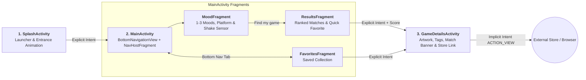

# GameMatch : Mood Based Video Game Recommender

**Course:** Mobile Computing
**Group Members:**
* Hachi Kawthar Khadidja - `kawthar.hachi@etu.cyu.fr`
* Taguelmimt Badis - `badis.taguelmimt@etu.cyu.fr`

---

## 1. Description of the Application
**GameMatch** is an offline-first Android application that recommends video games based on the player's current mood and preferred gaming platform.
Users select up to three moods (e.g., *Relaxed*, *Curious*, *Adventurous*) and a target platform, and the app scores and ranks matching games with tailored explanations.
Users can inspect full game details, visit external store pages, and save games to a personal favorites collection.

---

## 2. Activities & Navigation Flow



---

## 3. Intents Used
* **Explicit Intents (Inter-Activity Navigation):**
   ```mermaid
      flowchart LR
    Splash[<b>SplashActivity</b>] -->|Animation Complete| Main[<b>MainActivity</b>]

    subgraph MainActivity
        Results[<b>ResultsFragment</b>]
        Favorites[<b>FavoritesFragment</b>]
    end

    Results -->|EXTRA_GAME_ID, SCORE, EXPLANATION| Details[<b>GameDetailsActivity</b>]
    Favorites -->|EXTRA_GAME_ID| Details

    Main <-->|startService / stopService<br/>fav_count| Service[<b>GameReminderService</b>]
    Service -.->|PendingIntent<br/>Notification Tap| Main


* **Implicit Intents:**


---

## 4. Background Service & Activity Lifecycle Management
* **`GameReminderService` (`Service`)**: When the user puts `MainActivity` into the background (`onStop()`) while having at least one game saved in Favorites, `MainActivity` starts `GameReminderService` with the current favorite count. The service schedules a delayed background task via `Handler` and posts a status bar notification reminding the user of their saved games, then terminates itself (`stopSelf()`).
* **Lifecycle Handling**: When the user returns to the foreground (`onStart()`), `MainActivity` calls `stopService()` and `GameReminderService.onDestroy()` cancels any pending callbacks to prevent memory leaks or duplicate notifications.

---

## 5. Sensor Used
* **Accelerometer (`Sensor.TYPE_ACCELEROMETER`)**: Managed by `ShakeDetector` inside `MoodFragment`.
* **Functionality**: Normalizes X, Y, and Z acceleration axes against Earth's gravity (`SensorManager.GRAVITY_EARTH`) to compute G-force magnitude. When a shake exceeds `2.3g`, the app clears existing selections, randomly selects two moods, and automatically launches a search.
* **Lifecycle Management**: The sensor listener is registered in `MoodFragment.onResume()` and unregistered in `MoodFragment.onPause()` so the hardware sensor does not drain battery when the screen is inactive or in the background.

---

## 6. Architecture, Persistence & External Libraries
* **Architecture**: MVVM (`GameViewModel` + `LiveData`) separating UI rendering from matching logic (`MatchEngine`) and data storage.
* **Persistence & Offline Support**: Local game catalogue and persistent favorites storage *(update with Room / JSON details once merged)*, paired with disk-cached cover artwork.
* **Third-Party Libraries (Code Reuse < 50%)**:
  * **Glide (`com.github.bumptech.glide:glide:4.16.0`)**: Asynchronous image loading and offline disk caching with local drawable gradient fallbacks.
  * **AndroidX Navigation & Material Components**: Fragment navigation, bottom bar, and Material cards/chips.